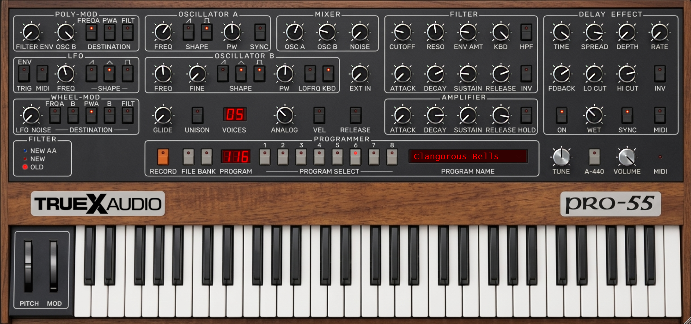

# Pro-55

A free polyphonic synthesizer for Windows x64 and Apple Silicon macOS. Windows packages are available as VST3, CLAP, or both formats together. An experimental Apple Silicon macOS beta is available as AUv2, VST3, and CLAP. Pro-55 builds on the [Cmajor Pro-54 synthesis engine](https://github.com/cmajor-lang/cmajor/tree/main/examples/patches/Pro54), itself a port of Native Instruments' Pro-53 DSP.

## The story behind Pro-55

Sequential Circuits' Prophet-5 helped make programmable polyphonic synths a part of the studio. Native Instruments later brought that sound to computers with the Pro-Five, Pro-52, and Pro-53. The Pro-52 and Pro-53 became influential VST instruments, and I've used them since they came out. Native Instruments eventually retired the Service Center activation system used by older products, while modern DAWs moved on from the older VST format.

I wanted to keep using these instruments in modern DAWs, with dependable 64-bit plugin formats and a larger, resizable interface. Cmajor's Pro-54 project brought the Pro-53 synthesis engine forward and gave me the starting point for Pro-55. I'm grateful to Native Instruments and Cmajor for the work that made this possible.

## What it does

Pro-55 has a 512-slot factory bank. Change controls in the interface, automate them from your DAW, and save sounds with your project. Project sounds are stored separately from the shared user bank, so changing the bank later won't change sounds already saved in a project.

## Download and install

### Windows x64 public beta

### Apple Silicon macOS beta

Choose the format supported by your DAW. See the [installation and sound-storage guide](Pro55/INSTALLATION.md), the [Pro-55 0.9.0-beta release](https://github.com/TruexAudio/Pro-55/releases/tag/v0.9.0-beta), and the matching [Apple Silicon macOS source snapshot](https://github.com/TruexAudio/Pro-55/releases/download/v0.9.0-beta/Pro-55-0.9.0-beta-macOS-arm64-source.zip).

We've checked AUv2 in GarageBand 10.4.14 and VST3 and CLAP in Bitwig Studio 6.0. The macOS builds target version 11.0 but have only been tested on macOS 26.6.2 on Apple Silicon. They are ad-hoc signed, not Developer ID signed or notarized, so macOS may show a security warning. Intel Macs and earlier macOS versions have not been tested.

## Sound storage

The factory bank has 512 slots, numbered 111–888. To save a sound in the shared user bank, press **RECORD** to capture it, choose a destination and optional name, then press **RECORD** again. Back up the user bank before replacing or resetting it. The [installation guide](Pro55/INSTALLATION.md) explains how project recall and the shared bank work.

## Known limitations

- The macOS builds are experimental Apple Silicon beta packages. Their host coverage is limited; broad DAW compatibility, Intel Macs, and macOS 11 compatibility have not been established.
- The Windows x64 plugins are unsigned and have no installer, activation, or telemetry.
- After the Pro-55 identity change, initial smoke tests passed for both Windows VST3 and CLAP. Earlier DAW checks used the previous Pro-54 identity: Bitwig (VST3 and CLAP), REAPER 6.15 (VST3), plus checks in Ableton Live and FL Studio. REAPER 7 CLAP and FL Studio project save/reload remain unverified with Pro-55.

## Build from source

The full source code is in this repository. See the [build instructions](Pro55/BUILDING.md) for Windows and Apple Silicon macOS toolchains, included dependencies, and commands. The source includes the native project, DSP source, factory bank and source, tests, runtime assets, build utilities, and third-party notices.

## Credits and licensing

New Pro-55 code and the interface are by **Grant Overend (TrueX Audio)** and licensed under AGPL-3.0. Some control artwork is adapted from the [Cmajor Pro-54 example](https://cmajor.dev/docs/Examples/Pro54/), used with permission and attribution. The inherited DSP and factory sounds also come from that example. Its DSP source retains GPL-3.0-or-later terms; other dependencies retain their own licences. Cmajor credits the original Native Instruments Pro-53. See [licensing](Pro55/LICENSING.md), [third-party notices](Pro55/THIRD_PARTY_NOTICES.md), and [artwork and preset provenance](Pro55/ASSET-PROVENANCE.md).
