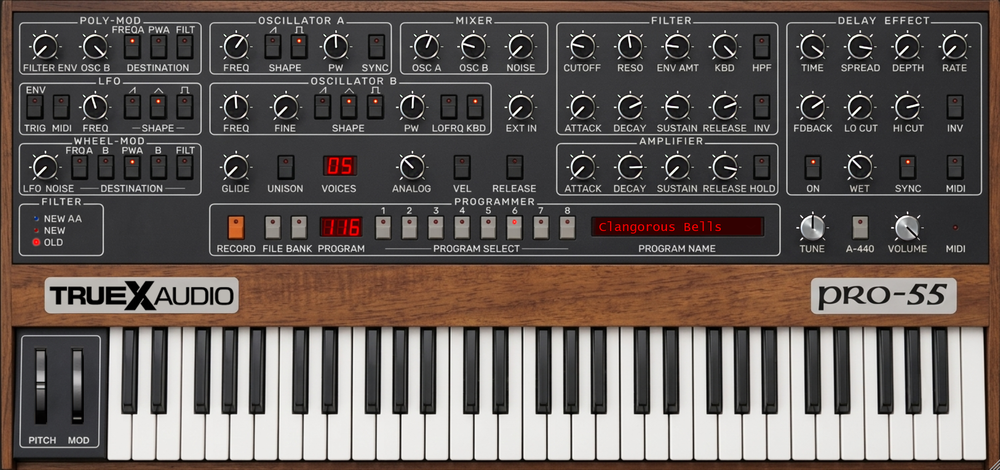

# Pro-55

A free polyphonic synthesizer inspired by the Sequential Circuits Prophet-5, for Windows x64 as VST3 and CLAP. It accepts MIDI input and produces stereo audio. Pro-55 is a TrueX Audio instrument built around the [Cmajor Pro-54 synthesis engine](https://github.com/cmajor-lang/cmajor/tree/main/examples/patches/Pro54), itself a port of Native Instruments' Pro-53.

## What it does

Pro-55 combines a polyphonic synthesizer with a 512-address patch programmer. Change controls in the interface, automate supported parameters from your host, and save edited sounds with your project. The shared user bank is separate; changing it does not alter sounds already saved in a project.

## Download and install

Windows x64 VST3-only, CLAP-only, and combined beta ZIPs will be published on [GitHub Releases](https://github.com/TruexAudio/Pro-55/releases) when the public beta launches. For now, this repository is in private release review and no public downloads are available. See the [installation and sound-storage guide](Pro55/INSTALLATION.md).

## Sound storage

The factory bank has 512 addresses, numbered 111–888. To save a sound into the shared bank, press **RECORD** to capture it, choose a destination and optional name, then press **RECORD** again. Back up the user bank before replacing or resetting it. The [installation guide](Pro55/INSTALLATION.md) explains how project recall and the shared bank work.

## Known limitations

- Windows x64 only. macOS, Linux, Audio Unit, and the development standalone are not included.
- The plugins are unsigned and have no installer, activation, or telemetry.
- After the Pro-55 identity change, initial smoke tests passed for both VST3 and CLAP. Earlier DAW checks used the previous Pro-54 identity: Bitwig (VST3 and CLAP), REAPER 6.15 (VST3), plus checks in Ableton Live and FL Studio. REAPER 7 CLAP and FL Studio project save/reload remain unverified with Pro-55.

## Build from source

The full source code is in this repository. See the [Windows build instructions](Pro55/BUILDING.md) for the toolchain, included dependencies, and commands. The source includes the native project, DSP source, factory bank and source, tests, runtime assets, build utilities, and third-party notices.

## Credits and licensing

New Pro-55 code and the interface are by **Grant Overend (TrueX Audio)** and licensed under AGPL-3.0. Some control artwork is adapted from the [Cmajor Pro-54 example](https://cmajor.dev/docs/Examples/Pro54/), used with permission and attribution. The inherited DSP and factory sounds also come from that example. Its DSP source retains GPL-3.0-or-later terms; other dependencies retain their own licences. Cmajor credits the original Native Instruments Pro-53. See [licensing](Pro55/LICENSING.md), [third-party notices](Pro55/THIRD_PARTY_NOTICES.md), and [artwork and preset provenance](Pro55/ASSET-PROVENANCE.md).
